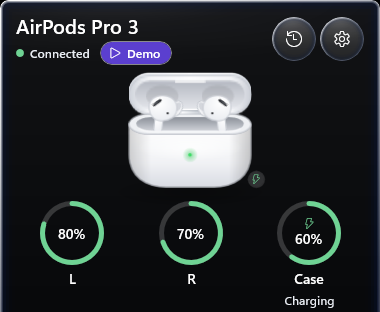
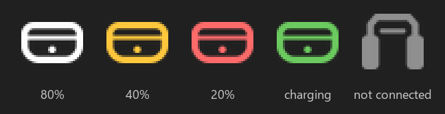
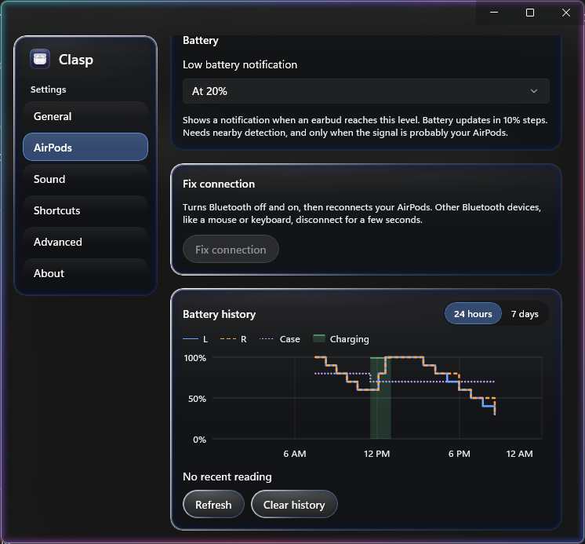
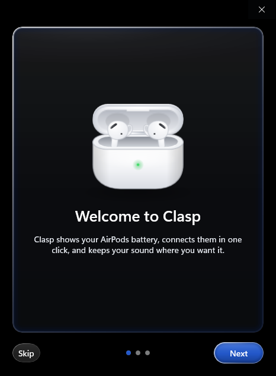
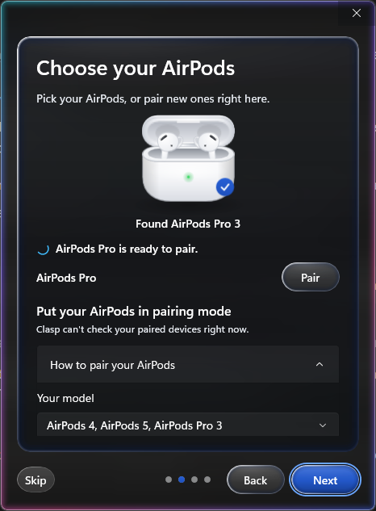

# Clasp

Clasp is a small, free Windows 11 tray app for AirPods and Beats. It shows the battery of each earbud and the case, connects your earbuds in one click, and keeps your sound going to the right place.

<p align="center">
  
</p>

*The screenshots in this README come from Clasp's Demo mode, so the numbers are made up and the flyout carries a "Demo" label.*

I built Clasp because Windows shows almost nothing about AirPods: no battery for the case, no quick way to reconnect, and a habit of sending sound to the wrong place. Clasp fills that gap without installing a driver or changing any Windows security setting. It runs for your user account only and needs no administrator rights.

Clasp is a hobby project by one person, released as open source under the GPL-3.0. It comes with no warranty, and I would rather tell you its limits up front than have you find them later. They are listed below.

Clasp is a 0.x preview. I support it on a best-effort basis, and things may change between versions.

**Jump to:** [What it does](#what-it-does) · [Which devices work](#supported-devices) · [Install](#download-and-install) · [Privacy](#privacy) · [Who makes this](#who-makes-this) · [Build from source](#building-from-source)

## What it does

Click the tray icon and a small panel opens with the battery level of each earbud and the case, a button to connect or disconnect, and a volume slider for your current sound output.

- **A tray icon that tells you something.** It shows the silhouette of your connected device (AirPods Pro, AirPods Max, Powerbeats and so on), or the last device you used, dimmed, when it is not connected. Its colour shows the battery: amber when low, red at your low-battery level, green while charging. There is no number on the icon; hover for the exact percentage, or click for full details.

  
- **Battery for every part.** Left earbud, right earbud and case, each with its own ring. When you take earbuds out of the case, they move out over their own rings.
- **Sound stays where you want it.** Clasp can remember the output you were using and switch back when your AirPods disconnect.
- **Play and pause.** Optionally, it presses Play when your AirPods connect and pause when they leave. It can also pause when you take them out of your ears. That last one is an estimate from nearby signals, so it can lag or miss a change, and it is off by default.
- **Battery history.** A chart for the last 24 hours or 7 days. If you only use your AirPods with this PC now and then, the long gaps shrink so the times you did use them stay readable.
- **Heads-up notices.** Optionally, it tells you when the battery is low, when you open the case, or when your AirPods have moved to another device.
- **Your actual model.** Each of the 21 supported AirPods and Beats models has its own picture. If your model comes in more than one finish, **Settings > AirPods > Device color** lets you pick yours.
- **Pair from Clasp.** The welcome guide lists AirPods and Beats that are in pairing mode, each with a **Pair** button, then connects the ones you pick. It also shows the right button presses to put your model into pairing mode, and a last page sets your main options before you finish.

<p align="center">
  
</p>

<p align="center">
  
  &nbsp;
  
</p>

You can pair new AirPods right in the welcome guide, or in Windows Settings as before. Nothing pairs until you click **Pair**, so someone else's AirPods in pairing mode nearby are never picked up by accident. Pairing in Clasp is tested with AirPods Pro 3. Headphones that ask for a code still need Windows Settings, and the guide has a link to it.

### How accurate is the battery?

Honestly, it is an estimate. Without a driver, the battery comes from the Bluetooth signals ("broadcasts") that your AirPods send out nearby, and those only report **steps of 10%**: 80%, 70%, 60%, never 83%. If more than one pair of AirPods is near you, Clasp can pick up the wrong one, and the panel says so when it is not sure.

### What it can't do yet

Clasp cannot switch AirPods between Noise Cancellation, Transparency and Adaptive, and it cannot read Apple's real ear-detection sensors. Apple sends those over a private control channel that Windows does not let ordinary programs reach. Getting to it needs a small Bluetooth driver, and Windows only loads drivers that Microsoft has signed, which is a slow process for an individual developer. The driver's source is in this repository, but it is not part of the app, and Clasp does not install anything like it. If you see listening-mode buttons in a Clasp screenshot, they belong to Demo mode.

## Supported devices

Clasp recognises these models from their Bluetooth broadcasts. I have only tested one of them on real hardware, and I would rather say so plainly.

| Model | Status |
| --- | --- |
| AirPods Pro 3 | Tested on real AirPods |
| AirPods 1st, 2nd and 3rd generation, AirPods 4 and 4 (ANC), AirPods 5, AirPods Pro, AirPods Pro 2 (Lightning and USB-C) | Recognised, not tested on my hardware |
| AirPods Max (Lightning and USB-C), AirPods Max 2 | Recognised, not tested on my hardware. Whether Clasp can tell when they are being worn is the least certain part |
| Powerbeats Pro, Powerbeats Pro 2, Beats Fit Pro, Beats Studio Buds+, Beats Solo Buds, Beats Solo 4, Beats Studio Pro, Beats Flex, Beats 360, BeatsX | Recognised, not tested on my hardware |
| Powerbeats 3, Powerbeats 4, Powerbeats Fit, Beats Solo 3, Beats Solo Pro, Beats Studio 3, Beats Studio Buds | Listed, but the battery layout is a best guess and I have not seen a real broadcast from them |

The model information comes from other open-source projects (LibrePods, CAPod and MagicPodsCore; see [THIRD-PARTY-NOTICES.md](THIRD-PARTY-NOTICES.md)). If your model shows the wrong battery, or Clasp calls it an "Unrecognised Apple audio device", please [open an issue](https://github.com/yirock7/Clasp-releases/issues/new/choose) and say which model you have. Reports from real hardware are the most useful thing anyone can give this project, and there is a [hardware report form](https://github.com/yirock7/Clasp-releases/issues/new?template=hardware-report.yml) for exactly that.

## Download and install

**You need:** Windows 11, 64-bit, and Bluetooth. You can pair your AirPods in Clasp's welcome guide after installing, or in Windows Settings.

Download the latest `Clasp-X.Y.Z-win-x64-setup.exe` from the [releases page](https://github.com/yirock7/Clasp-releases/releases/latest), together with its `.sig` file, and keep both in the same folder (your Downloads folder is fine).

**Check the signature before you run it.** I sign every installer with a private key that only I have. The check shows the file is the one I published and was not swapped or edited on the way to you. It matters more than usual because the installer is not code-signed yet (more on that below). Open PowerShell and run this, with `X.Y.Z` replaced by the version you downloaded:

```powershell
cd $env:USERPROFILE\Downloads
Invoke-WebRequest https://raw.githubusercontent.com/yirock7/Clasp-releases/clasp-v0.5.0/windows/hub/tools/Verify-ClaspInstaller.ps1 -OutFile Verify-ClaspInstaller.ps1
powershell -ExecutionPolicy Bypass -File .\Verify-ClaspInstaller.ps1 -Installer .\Clasp-X.Y.Z-win-x64-setup.exe
```

You should see `Signature OK: Clasp X.Y.Z`. If you see anything else, do not run the installer, and please [tell me](https://github.com/yirock7/Clasp-releases/issues). The script only reads the files; it never runs the installer.

An honest word about what this protects against. The checker is fetched from the source code at a fixed release tag, which is a different place from the download list, so it protects you if only a download has been swapped. The checker and the downloads do live under the same GitHub account, so it cannot protect you if that account itself were taken over. That is why I want proper code-signing as well (see below).

The public key it checks against is the one in [`UpdateSignature.cs`](windows/hub/src/AppleDeviceHub.Core/Updates/UpdateSignature.cs). Its SHA-256 fingerprint (of the key's DER bytes) is:

`1e656518818d696089c7d3e1688bdc34306926a8c23b87fc21b35fac53536176`

Once the signature is OK, run the installer. It installs for your account only, with no administrator prompt, under `%LOCALAPPDATA%\Programs\Clasp`.

**Windows will probably show a blue "Windows protected your PC" box.** That is because the installer is not code-signed yet: code-signing certificates cost money, and I have not bought one. Code-signing is coming: I plan to use the free code-signing that [SignPath](https://signpath.org) offers to open-source projects, and once that is in place the warning should go away. Until then, after the signature check passes, click **More info**, then **Run anyway**.

Each release also has a `.sha256` file, but it only shows the download was not damaged. Whoever could replace the installer could replace that file too, so it does not prove who published it.

**Updates** are checked more strictly than the first install. When Clasp downloads an update it checks a digital signature against a key built into the app, and refuses anything that does not match. Clasp only updates when you click **Update**. More detail is in [docs/INSTALLING-AND-UPDATING.md](docs/INSTALLING-AND-UPDATING.md).

## Privacy

Clasp has no accounts and no telemetry. Here is everything it stores and sends, as far as I can tell from reading the code:

- **On your PC**, in `%LOCALAPPDATA%\Clasp`: your settings, your battery history, and a small log (`hub.log`, kept under 512 KB). The log is written without device names or Bluetooth addresses (errors are recorded by type and code, not by message), but it is your file, so look it over before you share it. If `hub.log` cannot be written, a fallback log goes to `%TEMP%\Clasp-hub-fallback.log`. Downloaded updates are kept in `%LOCALAPPDATA%\Clasp\updates`. Nothing in these places is uploaded.
- **Over the internet**: only the update check, which asks GitHub for the list of releases, and the download if you choose to update. GitHub can see your IP address like any website you visit. Clasp sends no identifiers of its own. By default it does not check on its own; it asks you once whether you want automatic checks (daily, weekly or monthly), and you can change that in Settings.
- **Over Bluetooth**: Clasp listens to the broadcasts that nearby Apple devices send out, to read battery levels. While the welcome guide's pairing page is open, it also looks for headphones in pairing mode, the same search Windows Settings runs. It never pairs with or connects to anything without you asking. You can turn nearby detection off in Settings.

Because the source is public, you do not have to take my word for any of this. You can read it.

## Who makes this

Clasp is made by me, [yirock7](https://github.com/yirock7), on my own in my spare time. I build it with AI coding agents, and I review every change. I am not a company, and Clasp is not affiliated with or endorsed by Apple or Beats. AirPods, Beats and Apple are trademarks of Apple Inc., used here only to say which devices Clasp works with.

- **Open source.** The source code is in this repository under the [GNU General Public License v3.0](LICENSE). It comes with no warranty, as the licence says.
- **No telemetry.** See [Privacy](#privacy).
- **Verified updates.** Every installer is signed, and the app refuses any update whose signature does not match. See [Download and install](#download-and-install).
- **Security problems.** Please report them privately. [SECURITY.md](SECURITY.md) explains how, and what to expect from a one-person project.
- **Everything else.** Bugs, questions and ideas go in [issues](https://github.com/yirock7/Clasp-releases/issues/new/choose). I read everything, though I may be slow to answer.

## FAQ

**Is this from Apple?** No. See above.

**Why does Windows warn me about the installer?** It is not code-signed yet, so Windows does not know who I am. See [Download and install](#download-and-install).

**How do I uninstall it?** Windows Settings, Apps, Installed apps, Clasp. An interactive uninstall asks "Also delete Clasp's settings and battery history?". The default is No, which keeps your data so a reinstall picks up where you were. Say Yes to delete `%LOCALAPPDATA%\Clasp`. A silent uninstall always keeps it, so delete that folder yourself if you want it gone.

**Where are my settings?** In `%LOCALAPPDATA%\Clasp\settings.json`. Versions before the rename used `%LOCALAPPDATA%\AppleDeviceHub`; Clasp moves that folder across the first time the new version starts.

**It says it can't find my AirPods.** Make sure Bluetooth is on and open the case near your PC. If they have never been paired with this PC, pair them first: open the welcome guide (Settings, About, **Show welcome guide**), put them in pairing mode and click **Pair**, or use Windows Settings. The guide has model-specific pairing steps, and you can also read them in [docs/PAIRING-MODES.md](docs/PAIRING-MODES.md).

**I found a bug.** Please [open an issue](https://github.com/yirock7/Clasp-releases/issues/new/choose). Your Clasp version (Settings, About), Windows version and AirPods model help a lot.

## Building from source

You need the .NET 10 SDK. The short version is `dotnet test windows/hub/tests/AppleDeviceHub.Core.Tests -c Release`. The full steps, including Demo mode and building the installer, are in [docs/BUILDING.md](docs/BUILDING.md). If you would like to help, [CONTRIBUTING.md](CONTRIBUTING.md) explains how. The other documents are indexed in [docs/README.md](docs/README.md), and the history of changes is in [CHANGELOG.md](CHANGELOG.md).

## Credits and licence

Clasp is licensed under the [GNU General Public License v3.0](LICENSE). Portions are derived from [NTPods](https://github.com/arctumn/ntpods) by arctumn, which began as a Windows port of [LibrePods](https://github.com/kavishdevar/librepods). Model data also draws on CAPod and MagicPodsCore. The artwork is original. The full list of projects and libraries Clasp builds on, with their licences, is in [THIRD-PARTY-NOTICES.md](THIRD-PARTY-NOTICES.md).

Made by [yirock7](https://github.com/yirock7).
