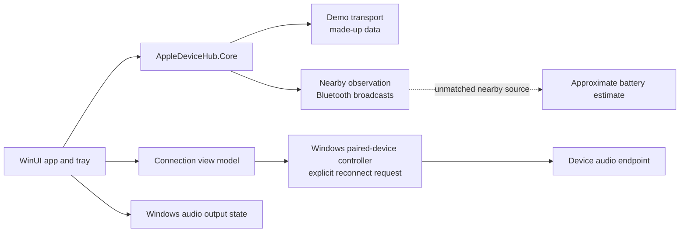

# Architecture

A short tour of how Clasp is put together, for people who want to read or change the code. For building it, see [BUILDING.md](BUILDING.md).

## The idea

Three things are kept separate on purpose, because mixing them is how apps end up lying to you:

1. **Nearby observation.** Bluetooth broadcasts from Apple devices, read passively. This gives battery estimates in 10% steps and "a case was opened nearby" prompts. Broadcasts can be heard from anyone's AirPods and can be faked, so they never decide which device is *yours*.
2. **Your paired device.** The device you picked from the ones paired in Windows. Its identity comes from Windows Bluetooth metadata. Clasp calls it connected only once Windows shows an active audio endpoint for it.
3. **Audio routing.** Which output Windows is currently using. Tracked separately, so choosing a device never silently changes your sound output.

Nearby detection and automatic reconnect are off by default. The app does not offer the advanced control-channel features (listening modes, true ear detection); see the README.

## Where things are

| Path | What it is |
|---|---|
| `windows/hub/src/AppleDeviceHub.Core` | Plain .NET, no UI. Rules and decisions: battery parsing, the model catalog, identity matching, settings, update checks and signature verification, view models. Testable without a device. |
| `windows/hub/src/AppleDeviceHub.App` | The WinUI 3 app: tray icon, flyout, case card, Settings, welcome guide, and the Windows audio and Bluetooth glue. |
| `windows/hub/tests` | Core tests. |
| `windows/hub/installer` | The per-user Inno Setup installer. |
| `windows/hub/tools` | Developer tools: icon generator, the update signer, the signature-check script, and a few Bluetooth probes. |
| `windows/daemon` | `clasp-engine`, an optional Rust program for hardware control. The app does not ship or start it. |
| `windows/drivers/aap` | Source of the optional Bluetooth driver. Not part of the app. |
| `windows/protocol/clasp-engine-v1` | The wire protocol between the app and the optional engine. |

## Core rules worth knowing

- **Unknown is not zero.** A value that was not reported is `null` and shows as unknown. Old values show as stale with their age.
- **Battery is per part.** Left, right and case are separate readings; out-of-range values become unknown, and a charging flag without a level is dropped.
- **Data origin is labelled.** Every state says whether it is demo, nearby or hardware data. Demo data is labelled "Demo" on screen.
- **One selected device.** The view model follows one device id. States for any other id are ignored, and out-of-order or duplicate states are dropped.
- **Hostile input is expected.** Anyone can broadcast Apple-looking Bluetooth packets. Incoming sightings are rate-limited, grouped once per observation, and a forged battery reading cannot trigger low-battery alerts.
- **The UI is not flooded.** Bursts of state changes are coalesced so the UI thread sees only the latest state.

## The tray, flyout and rendering

- **Tray icon.** A small wrapper over the Win32 notification area, so the flyout can be positioned next to the icon. It draws the silhouette of your selected device with the battery number, dimmed when disconnected, and picks a light or dark version from the taskbar theme. It re-adds itself after Explorer restarts.
- **Flyout.** One reusable borderless window with an acrylic backdrop and rounded corners, placed from the icon's rectangle onto the right monitor at that monitor's DPI. Clicking away or pressing Escape dismisses it.
- **Case card.** A small window that does not steal focus, shown near the bottom of the screen when a case is opened nearby. It stays quiet during full-screen apps and presentations.
- **Settings.** A normal resizable window.
- **Effects.** Windows' "Animation effects", "Transparency effects" and High contrast settings are respected, with overrides in Settings. Reduced transparency gives opaque surfaces; reduced motion removes movement and keeps short fades.

## Updates

Clasp checks the public GitHub release list (only when you allow it), downloads the installer when you click **Update**, verifies a signature against a key built into the app, and only then runs it. Details are in [INSTALLING-AND-UPDATING.md](INSTALLING-AND-UPDATING.md) and [RELEASING-UPDATES.md](RELEASING-UPDATES.md).

## The optional engine and driver

`windows/daemon` and `windows/drivers/aap` exist so that listening modes and true ear detection can come back one day. They need a Bluetooth driver that Microsoft has signed, which does not exist yet, so the shipped app neither starts the engine nor installs a driver. The app has a hardware transport that talks to the engine over a private, identity-checked pipe, but it is only used for development and cannot run on an ordinary PC.
